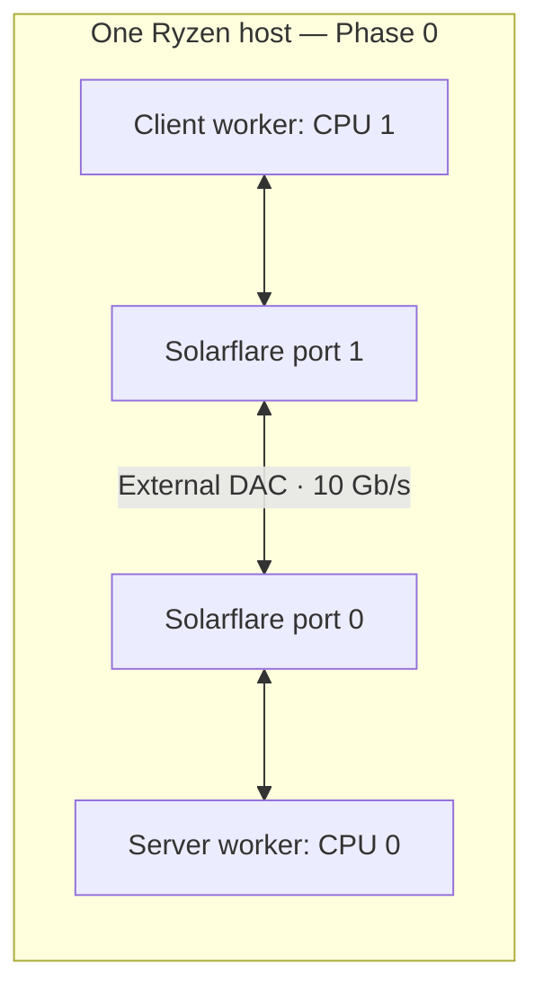

# R2 · eRPC on a modern NIC

## Phase 0: local testbed validation — advisor discussion

**Status:** software bring-up and repeated histogram measurements completed on a
single-host Solarflare testbed. The modern-NIC experiments are not yet completed.
Recorded measurements: September 5, 2026.

**Project question:** Which eRPC configuration choices remain effective on a
100 Gb/s or faster NIC, and how do receive-queue sizing, multi-packet RQs,
transmit inlining, doorbell batching, and completion signaling affect the
latency/throughput tradeoff?

Suggested opening:

> I built and exercised a local measurement harness on a dual-port Solarflare
> NIC connected by an external DAC. The tests sustain millions of round trips
> and show repeatable median latency and a clear concurrency plateau. This
> reduces software bring-up risk before moving to two hosts with ConnectX-6 or
> comparable hardware. The next phase will verify which NIC features are active
> and evaluate them through controlled experiments.

The target is CloudLab or another accessible testbed with suitable hardware.
Specific node availability, NIC model, and negotiated 100 Gb/s connectivity
still need to be confirmed. The local connection is **external port-to-port
cabling**, not enabled NIC-internal loopback.

## 1. What has been established

| Item | Current setup / evidence |
|---|---|
| Host | AMD Ryzen 5 PRO 5650G; 6 physical cores, 12 hardware threads; one NUMA node |
| Network | Dual-port Solarflare SFN8522 setup; `net_sfc_efx`; both links report 10 Gb/s |
| Topology | One host, port 0 ↔ DAC ↔ port 1 |
| Software | Locally installed DPDK 21.11.0 and modified eRPC checkout |
| Placement | Server CPU 0, client CPU 1; distinct physical cores; verified affinity after initialization |
| Timing | Five-second warmup, then approximately 30 seconds of measurement per point |
| Messages | Usually 64-byte request payload / 8-byte response payload; matched 120/64-byte Ethernet frames in DPDK baseline, excluding FCS |
| Correctness evidence | Sustained completions; 46 validated histograms: 25 latency, 18 concurrency, 3 DPDK; all 540 concurrency intervals made progress; zero reported NIC errors/missed packets in all three DPDK runs |

Bring-up fixes addressed two-port startup ordering, secondary-process device-info
queries, PMD-specific RX data offsets when returning mbufs, and a CPU-affinity
startup race. These demonstrate tested paths, not exhaustive validation of all
eRPC features, failure modes, message sizes, or NICs.

The single-host rate controls are opt-in through `--single_host_preflight=true`.
The stock server_rate config remains unchanged. Full replay instructions are in
[SOLARFLARE_LATENCY.md](SOLARFLARE_LATENCY.md), including daemon/server/client
startup order. Implementation details are in [DPDK baseline](dpdk_pingpong/README.md)
and [server_rate](apps/server_rate/README.md).



### 1.1 Boot configuration: aggressive low-latency tuning

The user supplied `/proc/cmdline`, matching `dmesg` command-line output, and
`grubby --info=DEFAULT` for **Rocky Linux 8.10**, kernel
`4.18.0-553.83.1.el8_10.x86_64`. The following is the supplied running command
line, including its duplicate entries:

```text
BOOT_IMAGE=(hd0,gpt2)/vmlinuz-4.18.0-553.83.1.el8_10.x86_64 root=/dev/mapper/rl-root ro crashkernel=auto resume=/dev/mapper/rl-swap rd.lvm.lv=rl/root rd.lvm.lv=rl/swap processor.max_cstate=1 idle=poll amd_iommu=on iommu=pt mitigations=off skew_tick=1 tsc=reliable rcupdate.rcu_normal_after_boot=1 skew_tick=1 tsc=reliable rcupdate.rcu_normal_after_boot=1
```

**Interpretation:** this is an aggressively tuned low-latency environment,
consistent with latency-sensitive/HFT-style practices. The flags alone do not
establish an HFT origin, a real-time kernel, or an optimal configuration.

| Flag | Meaning and experimental implication |
|---|---|
| `processor.max_cstate=1` | Limits ACPI processor idle-state depth where that driver applies. |
| `idle=poll` | Busy-polls during CPU idle instead of using normal idle states; trades power for wakeup behavior. |
| `amd_iommu=on iommu=pt` | Requests AMD IOMMU operation with passthrough mappings; supplied dmesg confirms the default domain is passthrough, not that the IOMMU is disabled. |
| `mitigations=off` | Requests disabling optional CPU vulnerability mitigations, trading protection for potential performance. |
| `skew_tick=1` | Staggers periodic ticks across CPUs to reduce synchronized contention; does not remove ticks. |
| `tsc=reliable` | Marks TSC trusted and bypasses selected checks; does not make an unreliable clock reliable or fix CPU frequency. |
| `rcupdate.rcu_normal_after_boot=1` | Uses normal rather than expedited RCU grace periods after boot. |

These descriptions follow the [kernel parameter reference](https://www.kernel.org/doc/html/latest/admin-guide/kernel-parameters.html)
and the [older-kernel reference](https://www.kernel.org/doc/html/v4.19/admin-guide/kernel-parameters.html).
Actual support and effect depend on this Rocky/RHEL kernel's backports and
configuration; appearance in `/proc/cmdline` alone is not verification of every
setting's effect.

`idle=poll` bypasses normal CPU-idle management, so the C-state limit is not an
independent additional tuning effect on that path. Polling can increase heat
and power and can impair performance through frequency/thermal effects.
Our DPDK workers already busy-poll during measurement; keeping other CPUs
polling may therefore matter as much as avoiding idle transitions on workers.
That last point is an experimental hypothesis, not measured attribution.
[CPU idle documentation](https://kernel.org/doc/html/v5.7/admin-guide/pm/cpuidle.html),
[NO_HZ documentation](https://kernel.org/doc/html/v5.16/timers/no_hz.html).

The triple `skew_tick=1 tsc=reliable rcupdate.rcu_normal_after_boot=1` occurs
twice in the running line. The saved GRUB entry contains it once followed by
`$tuned_params`. Expansion of that variable is a plausible source of the
second copy, but the active TuneD profile/environment has not been supplied.
The repetition is not evidence of a stronger tuning effect. No boot settings
were changed as part of this report update.

No `isolcpus`, `nohz_full`, or `rcu_nocbs` arguments appear in this snapshot.
Verified application affinity therefore should not be described as verified
OS/IRQ isolation. Runtime isolation or IRQ placement needs separate evidence.

**Measurement provenance:** this snapshot was supplied after the repeated-run
analysis. The saved histograms/logs do not contain per-run boot snapshots, so
we cannot retrospectively prove every trial used this exact configuration.
Record it as the currently reported host configuration, not a verified per-run
property. The current data establish local repeatability, not the benefit of
these boot flags relative to a stock system.

For the next series, save `/proc/cmdline`, `uname -r`, `tuned-adm active`, CPU
frequency/temperature, placement, and effective NIC settings with each batch.
Compare a documented baseline boot profile with this tuned profile while
holding the application workload fixed; then vary individual flags only if
attribution is needed. Use a consistent security/power policy when comparing
Solarflare with future ConnectX hardware.

## 2. Result A: repeatable median gap to the DPDK baseline

The current dataset has **five latency-app trials at each of five request
sizes**, **three six-window concurrency sweeps**, and **three 64-byte DPDK
trials**. All histograms match their source-log sample counts.

Tables show **mean of per-trial statistics [minimum, maximum]**. Plotted error
bars are observed between-trial min–max ranges, not confidence intervals.
Each trial is weighted equally; a mean of trial p99 values is not a pooled p99.
Zero-width ranges indicate agreement at HDR precision, not zero variability.


| 64-byte test | Trials | Median RTT (µs) | p99 RTT (µs) | p99.9 RTT (µs) |
|---|---:|---:|---:|---:|
| DPDK ping-pong | 3 | 7.70 [7.70, 7.70] | 8.50 [8.50, 8.50] | 13.73 [13.60, 13.90] |
| eRPC latency | 5 | 8.00 [8.00, 8.00] | 8.96 [8.80, 9.00] | 16.08 [15.30, 16.60] |

Every DPDK trial recorded a 7.7 µs median and every 64-byte eRPC latency
trial recorded 8.0 µs. The **observed median gap is 0.3 µs**. The p99.9 comparison
shows a larger tail difference: mean trial p99.9 is 13.73 versus 16.08 µs.

This does not establish a hardware floor or isolated 300 ns protocol cost.
The DPDK baseline includes allocation/copying, polling, and a software responder;
it uses one queue per port in one process. eRPC uses 16 configured queues and
daemon/secondary processes. Timing boundaries differ as well.

The paper's Table 2 compares eRPC with RDMA reads: CX4 medians are 3.7/2.9 µs
and CX5 medians 2.3/2.0 µs, respectively. Its Ethernet path uses direct
libibverbs packet I/O. This is a different baseline from our software DPDK
responder. [Original paper, §§3.3 and 6.1](https://www.usenix.org/system/files/nsdi19-kalia.pdf)

## 3. Result B: request-size sensitivity across five trials

All entries now come from the repeated post-affinity-fix latency-app series,
including 64 bytes. Payload sizes are **64/128/256/512/1024 bytes**, with an
8-byte reply. The earlier missing-64-byte and single-run limitations are
superseded by this dataset.

| Request bytes | Median RTT (µs) | p99 RTT (µs) | p99.9 RTT (µs) | Total measured samples |
|---:|---:|---:|---:|---:|
| 64 | 8.00 [8.00, 8.00] | 8.96 [8.80, 9.00] | 16.08 [15.30, 16.60] | 18,339,459 |
| 128 | 8.04 [8.00, 8.10] | 8.98 [8.90, 9.10] | 16.06 [15.10, 17.50] | 18,144,629 |
| 256 | 8.26 [8.20, 8.30] | 9.20 [9.10, 9.30] | 17.00 [15.70, 17.50] | 17,706,655 |
| 512 | 8.40 [8.40, 8.40] | 9.36 [9.30, 9.40] | 18.20 [16.10, 19.90] | 17,375,577 |
| 1024 | 9.24 [9.20, 9.30] | 10.54 [10.50, 10.60] | 21.02 [20.20, 22.80] | 15,758,548 |

Typical RTT rises modestly, from 8.00 to 9.24 µs, while mean trial p99.9
rises from 16.08 to 21.02 µs. Medians vary by at most 0.1 µs across trials at
each size; tail variation is larger. This establishes sensitivity to size,
not a breakdown into copying, DMA, serialization, or descriptor costs.

## 4. Result C: concurrency raises throughput until a plateau

| Window | Throughput (Mrps) | Median RTT (µs) | p99 RTT (µs) | p99.9 RTT (µs) |
|---:|---:|---:|---:|---:|
| 1 | 0.122 [0.121, 0.122] | 8.00 [8.00, 8.00] | 9.00 [9.00, 9.00] | 15.63 [15.20, 16.50] |
| 2 | 0.237 [0.237, 0.237] | 8.20 [8.20, 8.20] | 9.30 [9.30, 9.30] | 15.57 [15.40, 15.90] |
| 4 | 0.439 [0.439, 0.440] | 8.83 [8.80, 8.90] | 10.70 [10.60, 10.80] | 17.37 [17.00, 17.80] |
| 8 | 0.783 [0.782, 0.785] | 9.90 [9.90, 9.90] | 16.57 [16.50, 16.60] | 18.60 [18.40, 18.80] |
| 16 | 0.777 [0.776, 0.778] | 20.13 [20.10, 20.20] | 28.50 [28.50, 28.50] | 32.43 [32.30, 32.50] |
| 32 | 0.778 [0.777, 0.778] | 40.37 [40.30, 40.50] | 50.03 [49.90, 50.10] | 59.10 [56.70, 60.70] |


All 540 one-second concurrency intervals made progress and their counts match
the final summaries. From window 1 to 8, throughput grows approximately 6.4×
while median RTT rises from 8.0 to 9.9 µs. Windows 8–32 remain near 0.78 Mrps;
median RTT increases to 20.13 and then 40.37 µs. Window 8 is a useful observed
tradeoff, not a proven global optimum.

This is consistent with queueing at a processing limit. Little's law uses
**mean** response time: `N = X × R`. For window 32, `32 / 778000 ≈ 41 µs`,
consistent in scale with the median, but not a substitute for measuring the mean.
The sweep does not locate the bottleneck or prove the absence of retransmissions.
At approximately 0.78 Mrps, 120-byte requests consume roughly 0.90 Gb/s including
Ethernet overhead under a no-retry assumption, well below the 10 Gb/s link rate.
CPU, driver, queue, and NIC packet-processing limits remain possible.

### 4.1 Completed full-distribution plots

Each curve is a separate trial; colors group conditions. Histograms are not
pooled. The frequency plot shows the central peak; the CDF gives the fraction
at or below each RTT, while the CCDF reveals rare slow responses. CDF/CCDF plots
use log latency to display the full range, and CCDF uses log probability with
zeros omitted. Extreme-tail estimates have few supporting samples.


The distributions confirm a small typical-latency baseline gap, a shift toward
higher RTT with larger requests, and a substantial shift at window 32. Shapes
and tail differences are observations; component-level explanations still
require profiling and controlled changes.

## 5. Remaining evidence: configuration controls and bottleneck attribution

### A. Profile the plateau, without assuming that busy polling is the bottleneck

Keep the daemon and rate server running. In the client terminal:

```bash
bash apps/server_rate/run_preflight.sh client 8
```

After the five-second warmup, collect counters in another terminal:

```bash
sudo perf stat -A -C 0,1 \
  -e cycles,instructions,cache-misses,branches,branch-misses \
  -o phase0-perf-window8.txt -- sleep 10
```

`-C` selects CPUs and `-A` keeps their counts separate. This includes all tasks
on those CPUs, not just the workers. Counter availability and multiplexing must
be checked in the output. [perf stat documentation](https://man7.org/linux/man-pages/man1/perf-stat.1.html)

For sampled stacks, use a separate benchmark run:

```bash
sudo perf record -C 0,1 -F 99 --call-graph dwarf \
  -o phase0-perf-window8.data -- sleep 10
sudo perf report -i phase0-perf-window8.data --stdio
```

Call-graph recording can perturb performance. Use unprofiled runs for headline
latency/rate, and profiling runs to identify where execution samples occur.
[perf record documentation](https://man7.org/linux/man-pages/man1/perf-record.1.html)

Repeat at window 1 and 16, with distinct output names. Record client and server
separately; optionally identify worker TIDs and profile them rather than entire
CPUs. Do not assume a particular PMD symbol name before looking at the profile.

Report IPC (`instructions/cycles`) alongside instructions or cycles per
completed RPC over the **same interval**. High CPU utilization or many samples
in an RX polling function can simply mean waiting for packets. Low IPC alone
does not prove a memory bottleneck. Stronger evidence combines profiles with a
controlled intervention: change batch size, worker placement, or worker count
and observe whether the plateau moves. Capture NIC drops and eRPC retries too.

**Status:** profiling and component attribution are pending; no IPC or claimed
CPU-versus-NIC diagnosis is included in the measured results above.

### B. Repetition and distribution work: completed

The five size trials and three concurrency/DPDK trials are complete, with
per-trial dots, min–max error bars, frequency histograms, and full CDF/CCDF
plots above. Replay commands always export histograms in
[SOLARFLARE_LATENCY.md](SOLARFLARE_LATENCY.md). Further repeats should alternate
or randomize conditions and record the boot/TuneD state, temperature, and
frequency; tight medians alone do not rule out OS noise or thermal effects.

The next unmeasured quantities are aligned cycles/instructions per completed
RPC, actual batching, and NIC-drop/eRPC-retry counters. Match perf counters
and completion counts to the same interval. Do not divide a ten-second counter
sample by a full thirty-second completion count, or treat CPU frequency × RTT
as CPU execution cost: RTT includes waiting and concurrent requests overlap.

## 6. Phase 1: experiments on ConnectX-6 / 100 Gb/s or newer

First choose the transport scope with the advisor: **current DPDK/mlx5 eRPC**,
**a port of the paper-era raw-verbs path**, or a comparison of both. A different
NIC alone does not switch the implementation. The paper's multi-node rate and
scalability experiments also cannot be reproduced by our current two-process
single-host sweep. [Original paper, §§3.3 and 6.2–6.4](https://www.usenix.org/system/files/nsdi19-kalia.pdf)

Proposed sequence:

1. Obtain two suitable hosts; verify NIC model, link speed, PCIe width/speed,
   firmware, NUMA locality, and active driver/version. Confirm the exact topology.
2. Establish repeatable default eRPC and same-path packet baselines; add RDMA
   read/write baselines where appropriate for comparison with the paper.
3. Add explicit runtime/build controls for the selected experiments and record
   both requested and **effective** settings. Preserve a known default configuration.
4. Change one factor at a time, then test a small number of motivated interactions.
5. Evaluate low-concurrency latency, small-message rate, and large-message goodput
   separately. Keep packet sizes, concurrency, and CPU resources comparable.

| Factor | Proposed experiment | Evidence needed | Main plots |
|---|---|---|---|
| RX queue depth | Sweep supported depths, e.g. 128–4096, with queues/cores fixed | Actual descriptors, memory use, RX no-buffer/drop counters | Mrps and p99 versus depth |
| MPRQ | Compare verified off/on; then vary supported stride settings | Active RX function/config, stride count/size, buffer ownership and copies | Rate/latency versus size, separated by MPRQ setting |
| TX inlining | Sweep supported maximum inline lengths around tested frame sizes | Effective inline policy and active TX path | Median/p99 and Mrps versus inline threshold |
| Doorbell batching | Vary application burst limit; instrument actual posting behavior | Actual burst distribution and doorbell/WQE observations where available | Rate and p99 versus effective batch size |
| Unsignaled sends / completion cadence | Tune signaling in a path exposing it, or a supported PMD reclamation control | Which work produces CQEs, reclamation cadence, buffer use | Cycles/RPC, rate, and tails versus cadence |

For DPDK 21.11 mlx5, `mprq_en` is also subject to `rxqs_min_mprq` (default 12).
Thus a one-queue baseline and 16-queue eRPC setup can activate different paths.
MPRQ may copy small packets or attach external buffers; it must not be described
as automatically zero-copy. Inlining depends on queue-count thresholds as well
as `txq_inline_max`, and consumes CPU cycles. Verify effective settings and
buffer lifetime compatibility, especially with secondary processes. Re-check
these details for the DPDK version actually deployed. [mlx5 driver documentation](https://doc.dpdk.org/guides-21.11/nics/mlx5.html)

In this checkout, the raw-verbs transport explicitly controls `kUnsigBatch` and
`kMaxInline`; the DPDK transport's similarly named `kUnsigBatch` is described as
an array-sizing aid, not a hardware completion knob. Changing it would not be a
valid unsignaled-transmit experiment. Likewise, an application TX burst size is
not guaranteed to equal one hardware doorbell batch. Inspect and instrument the
selected implementation. [Raw constants](src/transport_impl/raw/raw_transport.h)
[DPDK constants](src/transport_impl/dpdk/dpdk_transport.h)

## 7. Meeting figures and next experiments

| Figure / evidence | Status |
|---|---|
| One-host/two-port testbed and boot configuration | Documented in section 1; per-run boot provenance still missing |
| Baseline and size/window plots with min–max error bars | Complete: 5 size trials, 3 concurrency/DPDK trials |
| Frequency histograms and full CDF/CCDF | Complete; individual trials retained |
| Boot-profile comparison and power/thermal measurements | Pending; required to attribute tuning effects |
| Profiles and aligned cycles/instructions per RPC | Pending; needed to investigate the throughput plateau |
| MPRQ/inlining/RX-depth/batching/completion experiments | Phase 1 on verified modern hardware |
| Large-message goodput | Pending; small-RPC rate is not bulk bandwidth |

## 8. Decisions for the advisor

- Is R2 primarily reproduction, modern-hardware re-evaluation, or a tuning study?
- Which transport implementation is the main experimental subject?
- Can we secure two comparable ConnectX-6-or-newer hosts and the required link?
- Which boot/security/power baseline should be held fixed across testbeds?
- Which mechanisms should be tested first: MPRQ/inlining or RX-depth/batching?
- What further repetitions and profiling evidence should precede causal claims?

Phase 0 now establishes an instrumented, repeatable local workflow with full
latency distributions. The aggressive reported boot profile is part of the
experimental context, not evidence that NIC features caused the results.

## 9. Data and reproduction

The source of the updated tables is the same validated dataset used in
[SOLARFLARE_LATENCY.md](SOLARFLARE_LATENCY.md):

- [Per-trial statistics](results/solarflare/repeated-20260905/per-trial.csv)
- [46 retained histograms](results/solarflare/repeated-20260905/histograms/)
- [Source manifest and histogram checksums](results/solarflare/repeated-20260905/manifest.json)
- [31 archived source text logs](results/solarflare/repeated-20260905/raw-logs.tar.gz)
- [Reproducible analysis/plotting script](scripts/plot_solarflare_repeated.py)

Loose processed logs were removed after byte-for-byte archival verification;
the evidence remains reproducible. Older exploratory measurements are excluded
from these repeated-trial tables. Before the next series, also preserve the
exact commit and local diff, launch commands, software/firmware versions,
topology, boot/TuneD state, placement, and effective NIC settings.
