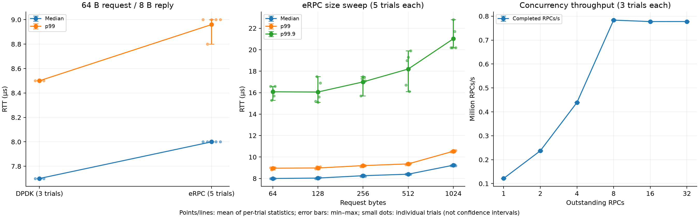
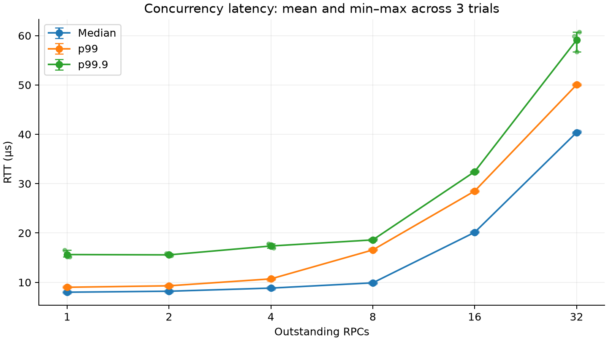
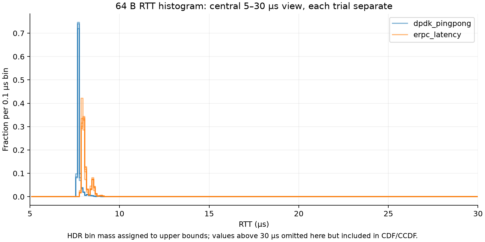
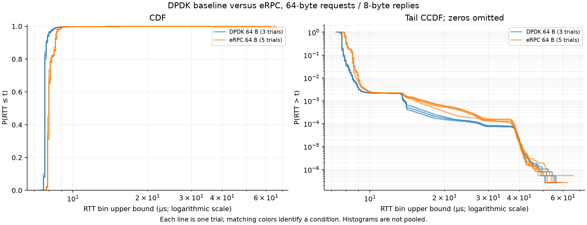
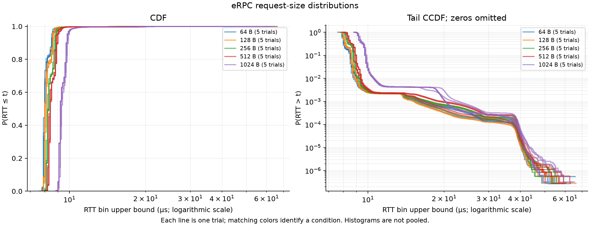
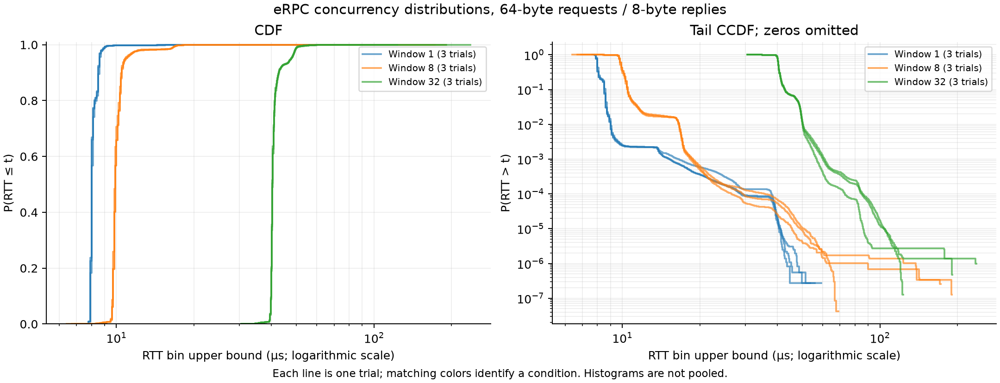

# Solarflare preflight: run tests and always save histograms

Advisor discussion: [R2 · Phase 0 Testbed Validation](R2_PHASE0_TESTBED_VALIDATION.md).

We still run the same Solarflare benchmarks. **Every collection command below
saves both a text log and a full HDR histogram CSV.** The histogram is an
additional output, not a different benchmark. Use this workflow for new runs.

| Output | Purpose |
|---|---|
| `.txt` | Progress, final percentiles, sample counts, and throughput where available |
| `.hist.csv` | Latency-bin bounds and counts for full CDF/CCDF plots |
| `.png` / `.svg` | Figures generated later from the saved data |

All measured latencies are full round trips (RTT). Histograms exclude warmup
and are written after measurement. They retain HDR bin precision, not raw
per-RPC timestamps. Old percentile-only logs cannot reconstruct full histograms.

## Setup and build once

Run commands as your regular user; the launch scripts invoke sudo. In every
terminal, start from the repository root:

```bash
cd /home/isaaclee/eRPC
```

Connect Solarflare port 0 to port 1 with the DAC cable. The current setup uses
NUMA node 0, server CPU 0, and client CPU 1. The process addresses in
`scripts/autorun_process_file` must belong to this host (currently configured
as `192.168.8.175`).

```bash
cmake -S . -B . -DERPC_BUILD_SERVER_RATE=ON
cmake --build . --target latency server_rate erpc_dpdk_daemon -j4
bash dpdk_pingpong/build.sh
```

Run one benchmark at a time. Start with the standalone baseline, then the eRPC
size sweep, then the concurrency sweep. Each condition uses 5 seconds warmup
and 30 seconds measurement. Use three trials for repeatability.

## 1. DPDK ping-pong baseline — one terminal

**First stop any eRPC clients, servers, and daemon, in that order.** This test
owns both ports itself and starts its own responder thread. It needs no
separate daemon or server window.

```bash
for trial in 1 2 3; do
  bash dpdk_pingpong/run.sh 64 || break
done
```

This measures 64-byte requests and 8-byte replies with one outstanding request.
Each run exits and releases the ports. Allow about two minutes plus startup.

Files are saved under `dpdk_pingpong/`, with matching names:

```text
pingpong_64_TIMESTAMP_PID.txt
pingpong_64_TIMESTAMP_PID.hist.csv
```

Inspect the final measurement row and NIC counters. A response timeout fails
the run; this baseline does not retransmit. See [implementation details](dpdk_pingpong/README.md).

## 2. eRPC latency size sweep — three terminals

This measures **64, 128, 256, 512, and 1024-byte requests**, with 8-byte replies
and one outstanding RPC. Each size gets its own measurement and histogram.

### Terminal 1: start the daemon and leave it running

```bash
sudo -E ./build/erpc_dpdk_daemon \
  --phy_port=0 --peer_phy_port=1 \
  --numa_node=0 --loopback=false
```

Wait for `All managed links are up; ready for applications` before proceeding.
Reuse an already-running daemon with these settings; do not start a second one.

### Terminal 2: start the latency server and leave it running

```bash
sudo -E ./build/latency $(cat apps/latency/config) \
  --process_id=0 --numa_node=0 --numa_0_ports=0 --resp_size=8
```

Confirm `Running as secondary DPDK process` and that the worker is pinned to
CPU 0 after transport initialization. If it reports primary, stop and check
the daemon. The client should report CPU 1. Workers verify their affinity masks.

### Terminal 3: collect all five sizes, three times

```bash
bash scripts/collect_solarflare_histograms.sh 3
```

**This is the standard latency collection command going forward.** For a single
trial, replace `3` with `1`. There is no separate histogram test to run afterward.
The older `collect_solarflare_latency.sh` remains available for compatibility;
you do not need it for this workflow.

Three trials take about nine minutes plus startup. Leave the daemon and server
running until the collection script finishes. Each size/trial saves paired files
in the repository root:

```text
solarflare_latency_TIMESTAMP_PID_trial1_64B.txt
solarflare_latency_TIMESTAMP_PID_trial1_64B.hist.csv
```

The trial number and request size change for each pair. Use the final
`30 seconds` row for that run's percentiles. The per-second rows are cumulative,
not independent trials. A failed or interrupted run is not a completed trial;
check that its histogram exists before using it.

**Next:** after the collection finishes, stop the latency server in terminal 2.
Keep the daemon in terminal 1 running for the concurrency test.

## 3. eRPC server_rate concurrency sweep — reuse the three terminals

This measures small-RPC throughput and RTT as the number of outstanding RPCs
increases: **windows 1, 2, 4, 8, 16, and 32**, all with 64-byte requests and
8-byte replies. Stop both latency processes before starting server_rate.

### Terminal 1: keep the same daemon running

If you stopped it, restart it with the daemon command from section 2 and wait
for the ready message.

### Terminal 2: start the server_rate server

```bash
bash apps/server_rate/run_preflight.sh server
```

Confirm secondary-process attachment and server CPU 0.

### Terminal 3: collect three complete window sweeps

```bash
for trial in 1 2 3; do
  bash apps/server_rate/run_preflight.sh sweep || break
done
```

Allow about eleven minutes plus startup. Each invocation is one trial and saves
one text log plus six histogram files in the repository root:

```text
server_rate_preflight_TIMESTAMP_PID.txt
server_rate_preflight_TIMESTAMP_PID_w1.hist.csv
server_rate_preflight_TIMESTAMP_PID_w2.hist.csv
server_rate_preflight_TIMESTAMP_PID_w4.hist.csv
server_rate_preflight_TIMESTAMP_PID_w8.hist.csv
server_rate_preflight_TIMESTAMP_PID_w16.hist.csv
server_rate_preflight_TIMESTAMP_PID_w32.hist.csv
```

For a single-window check, `bash apps/server_rate/run_preflight.sh client 8`
also saves its text log and histogram automatically.

Read `PREFLIGHT_SUMMARY` for each window. `mrps` means millions of completed
RPCs per second; the latency statistics are cumulative after warmup. Completion
counts can exceed latency sample counts because RPCs crossing the warmup
boundary are excluded from the latency histogram.

The script enables `--single_host_preflight=true`. That gate defaults off in
the application; the stock configuration remains available for later multi-host
Mellanox experiments. See [server_rate details](apps/server_rate/README.md).

**Finish:** let the client exit, stop the server in terminal 2, then stop the
daemon in terminal 1. Stop all three before running standalone DPDK again.

## Full CDF and tail CCDF collection

The commands above already collect everything needed. Plotting is a separate,
offline step and does not require the NIC, daemon, or servers.

Use `scripts/plot_hdr.py` with the saved `.hist.csv` files. Start by comparing
windows 1, 8, and 32 from **the same trial**. Set `prefix` to the actual shared
filename prefix of that trial, without `_w1.hist.csv`:

```bash
prefix='server_rate_preflight_TIMESTAMP_PID'
PYTHONPATH=/tmp/erpc-plot-deps MPLCONFIGDIR=/tmp/erpc-mpl python3.11 scripts/plot_hdr.py \
  "${prefix}_w1.hist.csv" "${prefix}_w8.hist.csv" "${prefix}_w32.hist.csv" \
  --labels 'Window 1' 'Window 8' 'Window 32' \
  --output "results/solarflare/${prefix}-distributions"
```

Replace `TIMESTAMP_PID` with your actual filename values before running. The
local setup has Matplotlib under `/tmp/erpc-plot-deps`; if it is installed in
your Python environment, the environment-variable prefixes are unnecessary.

For the size comparison, set `prefix` to one trial's prefix:

```bash
prefix='solarflare_latency_TIMESTAMP_PID_trial1'
PYTHONPATH=/tmp/erpc-plot-deps MPLCONFIGDIR=/tmp/erpc-mpl python3.11 scripts/plot_hdr.py \
  "${prefix}_64B.hist.csv" "${prefix}_128B.hist.csv" \
  "${prefix}_256B.hist.csv" "${prefix}_512B.hist.csv" "${prefix}_1024B.hist.csv" \
  --labels '64 B' '128 B' '256 B' '512 B' '1024 B' \
  --output "results/solarflare/${prefix}-distributions"
```

Each command writes PNG and SVG figures. The same plotter accepts DPDK and
eRPC histograms together; match request/reply sizes and give each input a label.

- **CDF:** fraction of RTT samples at or below a latency. It rises sharply near
  the typical RTT and approaches 1.
- **CCDF:** fraction exceeding that latency, with a logarithmic probability
  axis to expose rare slow responses. Zero values cannot appear on a log axis.

These are cumulative probability plots, not frequency-density plots. With N
samples, tail probabilities below 1/N are unobservable. The plotter validates
that exported bin counts sum to the recorded sample count.

For repeatability, compare each condition across its three trials. Plot the
three per-trial medians (or p99 values), with a mean and min–max error bars clearly
labeled. These are between-trial ranges, not confidence intervals. Keep trials
separate initially; do not silently pool histograms or treat cumulative
one-second rows as independent trials.

## What the tests tell us

| Test | Main question |
|---|---|
| DPDK ping-pong | What RTT does the NIC/driver/platform plus a minimal software responder deliver? |
| eRPC latency, window 1 | How does full eRPC RTT compare, and how does it change with request size? |
| eRPC server_rate, windows 1–32 | How much throughput does concurrency enable, and how does queueing affect RTT? |

The baseline uses one queue per port and two threads in a primary process.
eRPC uses a daemon and secondary processes with 16 configured queues per port.
The baseline timer includes allocation, copying, submission, and reply handling.
Its difference from eRPC is diagnostic, not an isolated measurement of protocol
overhead or a pure hardware latency floor.

## Historical results — repeated histogram measurements, 2026-09-05

Validated **five eRPC size-sweep trials**, **three concurrency sweeps**, and
**three DPDK baseline trials**: 46 complete measured distributions. Every run
used 5 seconds warmup and 30 seconds measurement, with 8-byte responses.
Histogram totals match the corresponding text logs; all required measurement
intervals completed. The three DPDK runs reported zero missed packets, RX/TX
errors, and RX allocation failures on both ports.

These are Phase 0 single-host Solarflare measurements. DPDK and eRPC have the
configuration differences described above; their RTT gap is not isolated
protocol overhead.

### Repeatability and error bars

Tables show **mean of per-trial statistics [minimum, maximum]**. Error bars show
the same observed between-trial range, not standard deviation or a confidence
interval. Each trial has equal weight. A zero-width median range means the
recorded medians agree at HDR precision; it does not prove zero timing variation.



| 64-byte test | Trials | Median RTT (µs) | p99 RTT (µs) | p99.9 RTT (µs) |
|---|---:|---:|---:|---:|
| DPDK ping-pong | 3 | 7.70 [7.70, 7.70] | 8.50 [8.50, 8.50] | 13.73 [13.60, 13.90] |
| eRPC latency | 5 | 8.00 [8.00, 8.00] | 8.96 [8.80, 9.00] | 16.08 [15.30, 16.60] |

### Request-size sweep: five trials per size

| Request bytes | Median RTT (µs) | p99 RTT (µs) | p99.9 RTT (µs) | Total measured samples |
|---:|---:|---:|---:|---:|
| 64 | 8.00 [8.00, 8.00] | 8.96 [8.80, 9.00] | 16.08 [15.30, 16.60] | 18,339,459 |
| 128 | 8.04 [8.00, 8.10] | 8.98 [8.90, 9.10] | 16.06 [15.10, 17.50] | 18,144,629 |
| 256 | 8.26 [8.20, 8.30] | 9.20 [9.10, 9.30] | 17.00 [15.70, 17.50] | 17,706,655 |
| 512 | 8.40 [8.40, 8.40] | 9.36 [9.30, 9.40] | 18.20 [16.10, 19.90] | 17,375,577 |
| 1024 | 9.24 [9.20, 9.30] | 10.54 [10.50, 10.60] | 21.02 [20.20, 22.80] | 15,758,548 |

### Concurrency sweep: three trials per window

| Window | Throughput (Mrps) | Median RTT (µs) | p99 RTT (µs) | p99.9 RTT (µs) |
|---:|---:|---:|---:|---:|
| 1 | 0.122 [0.121, 0.122] | 8.00 [8.00, 8.00] | 9.00 [9.00, 9.00] | 15.63 [15.20, 16.50] |
| 2 | 0.237 [0.237, 0.237] | 8.20 [8.20, 8.20] | 9.30 [9.30, 9.30] | 15.57 [15.40, 15.90] |
| 4 | 0.439 [0.439, 0.440] | 8.83 [8.80, 8.90] | 10.70 [10.60, 10.80] | 17.37 [17.00, 17.80] |
| 8 | 0.783 [0.782, 0.785] | 9.90 [9.90, 9.90] | 16.57 [16.50, 16.60] | 18.60 [18.40, 18.80] |
| 16 | 0.777 [0.776, 0.778] | 20.13 [20.10, 20.20] | 28.50 [28.50, 28.50] | 32.43 [32.30, 32.50] |
| 32 | 0.778 [0.777, 0.778] | 40.37 [40.30, 40.50] | 50.03 [49.90, 50.10] | 59.10 [56.70, 60.70] |



Increasing concurrency initially raises throughput. Beyond window 8, the rate
changes little while RTT rises substantially. This is consistent with queueing
at a processing limit, but does not identify whether the limit is in the client,
server, PMD, or NIC. These repetitions characterize observed variation; they do
not rule out thermal or operating-system interference.

### Full histograms, CDFs, and tail CCDFs

Every curve below is one trial; colors group identical conditions. No trials
are pooled and no curves are reconstructed from a few percentile points.
The frequency histogram shows the peak; the CDF and CCDF retain the full range,
including rare slow samples. The CCDF uses log probability; distribution plots
also use log latency to keep the full tails visible. Zero CCDF values are
omitted. Far-tail estimates supported by only a few samples are unstable.









### Saved data and reproduction

- [Per-trial statistics](results/solarflare/repeated-20260905/per-trial.csv)
- [All 46 histogram CSVs](results/solarflare/repeated-20260905/histograms/)
- [Source filenames and histogram SHA-256 checksums](results/solarflare/repeated-20260905/manifest.json)
- [Compressed source text logs](results/solarflare/repeated-20260905/raw-logs.tar.gz)
- [Analysis and plotting script](scripts/plot_solarflare_repeated.py)

PNG and SVG versions of each plot are in the results directory. Source text
logs from these completed trials are archived together; loose copies are removed
after validation. Histogram CSVs are retained. Older exploratory logs are not
part of this cleanup or this repeated-trial analysis.

Recreate the tables and figures from the preserved dataset without NIC access:

```bash
PYTHONPATH=/tmp/erpc-plot-deps MPLCONFIGDIR=/tmp/erpc-mpl python3.11 scripts/plot_solarflare_repeated.py
```

The script writes `results/solarflare/repeated-20260905/report-section.md` alongside
the figures. This replaces the earlier single-run historical comparison for
current discussion; older reference figures remain in `results/solarflare/`.
